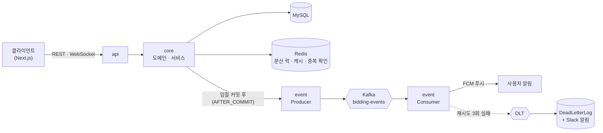

# HandsUp - 중고 경매 거래 플랫폼 (Backend)

[](https://github.com/ParkJuhan94/handsup-backend/actions/workflows/ci.yml)

물품을 등록하고 실시간으로 입찰하며, 채팅으로 거래하는 경매 서비스입니다. 프로그래머스 데브코스 팀 프로젝트(2024.02)로 시작했고, 이후 백엔드를 혼자 이어서 고도화하고 있습니다.
팀 단계와 개인 고도화 전반(2025)은 직접 설계·구현했고 AI는 검색·질문 보조로만 썼습니다. 2026년 6월부터 Claude Code를 사용했으며, 이 단계에서는 설계와 검증은 제가 하고
구현은 AI와 함께했습니다. 프론트엔드는 팀원들이 만든 것을 포크해 이 백엔드와 연동했습니다.

- 프론트엔드 : [ParkJuhan94/handsup-frontend](https://github.com/ParkJuhan94/handsup-frontend) (팀 프론트 [Programmers-HandsUp/FE-HandsUp](https://github.com/Programmers-HandsUp/FE-HandsUp)을 포크)
- 팀 프로젝트 원본 : [Programmers-HandsUp/BE-handsup](https://github.com/Programmers-HandsUp/BE-handsup)
- 작성 기준 : 2026-10-22, `main` 브랜치 커밋 `00c7d44` 시점의 코드와 구성 (이후 변경은 반영되지 않을 수 있습니다)

<div align="left">
  
</div>

<br>

## 팀 단계와 개인 고도화

| 구분 | 내용 |
|------|------|
| 팀 단계 (2024.02 ~ 06) | JWT 액세스·리프레시 인증과 인터셉터, 경매·입찰·리뷰·알림 도메인, DB 조회 최적화와 캐시 도입, 성능 테스트. 배포 파이프라인은 팀원이 구축 |
| 개인 고도화 (2025) | Docker·CD 재구성, 추천 API 2단 캐시, 입찰 알림 Kafka 분리(재시도·DLT·중복 처리), Kafka 별도 서버 분리 |
| 개인 고도화 (2026, Claude Code) | 분산 락 순서 버그 수정, 인증 토큰 회전(#104), 포이즌 필 처리(#110), 로컬 환경 정리 |

<br>

## 아키텍처



```
api     → REST API, WebSocket 엔드포인트, 인증 인터셉터
core    → 핵심 비즈니스 로직 (Service, Domain, Repository)
event   → Kafka 이벤트 처리 (Producer / Consumer, 재시도 · DLT)
```

> 의존 방향: `api → core, event` / `event → core`

<br>

## 기술 스택

| 분류 | 기술 |
|------|------|
| Backend | Java 17, Spring Boot 3.2, JPA, QueryDSL |
| Messaging | Kafka (운영: Apache Kafka 별도 EC2 / 로컬: Redpanda) |
| DB / Cache | MySQL, Redis (Redisson), Caffeine |
| Infra / CI·CD | Docker, AWS EC2 · S3, GitHub Actions |
| Test | JUnit 5, Mockito, Testcontainers, Embedded Kafka, JaCoCo + Codecov |
| 기타 | JWT(jjwt), Swagger, Firebase FCM, OpenAI API |

<br>

## 로컬 실행

```bash
# 인프라 (MySQL 3307, Redis 6380, Redpanda 29092)
cp .env.example .env   # 값 채우기
docker compose --env-file .env up -d mysql redis redpanda

# 서버 (기본 포트 8082)
./gradlew :api:bootRun
```

- Swagger : http://localhost:8082/swagger-ui/index.html
- 프론트와 연결하려면 [handsup-frontend](https://github.com/ParkJuhan94/handsup-frontend)를 `npm run dev`로 띄웁니다(3004).

<br>

## 상세 자료

<details>
<summary><b>DB ERD</b></summary>


</details>

<details>
<summary><b>CI/CD Pipeline (팀 단계)</b></summary>


> 현재 CD는 배포 서버를 꺼 둔 상태라 push로 자동 실행하지 않고, Actions 탭에서 수동 실행합니다.

</details>

<details>
<summary><b>API 리스트</b></summary>


</details>

<details>
<summary><b>테스트 결과</b></summary>


</details>

<br>

## 팀원 소개

| 구분 | 이름 | GitHub |
|------|------|--------|
| 백엔드 (팀장) | 손가현 | [@hyun2371](https://github.com/hyun2371) |
| 백엔드 | 박주한 | [@ParkJuhan94](https://github.com/ParkJuhan94) |
| 프론트엔드 (팀장) | 허지호 | [@hj9118](https://github.com/hj9118) |
| 프론트엔드 | 신준혁 | [@oridori2705](https://github.com/oridori2705) |
| 프론트엔드 | 현세인 | [@imssein](https://github.com/imssein) |
| 프론트엔드 | 주장권 | [@JuJangGwon](https://github.com/JuJangGwon) |
