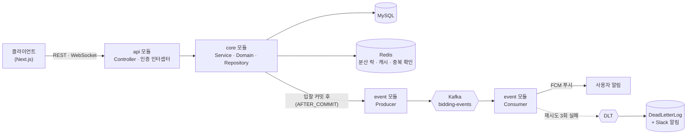

# HandsUp - 중고 경매 거래 플랫폼 (Backend)

> 물품을 등록하고 실시간으로 입찰하며, 채팅으로 거래하는 경매 웹 서비스

[](https://github.com/ParkJuhan94/handsup-backend/actions/workflows/ci.yml)

- 프론트엔드 👉🏻 [ParkJuhan94/handsup-frontend](https://github.com/ParkJuhan94/handsup-frontend) (팀 프론트 [Programmers-HandsUp/FE-HandsUp](https://github.com/Programmers-HandsUp/FE-HandsUp)을 포크해 이 백엔드와 연동)
- 팀 프로젝트 원본 👉🏻 [Programmers-HandsUp/BE-handsup](https://github.com/Programmers-HandsUp/BE-handsup)

<div align="left">
  
</div>

<br>

## 📌 한눈에 보기

| 항목 | 내용 |
|------|------|
| 기간 | 팀 단계 2024.02 ~ 2024.04 (프로그래머스 데브코스, 백엔드 2명 · 프론트엔드 4명) / 개인 고도화 2025.03 ~ |
| 내 역할 | 팀 단계: 인증·인가, 경매·입찰·리뷰·알림 도메인 / 개인 단계: 이벤트 기반 알림, 동시성, 인증 보안, 운영 안정성 |
| 핵심 기술 | Java 17, Spring Boot 3.2, JPA · QueryDSL, MySQL, Redis(Redisson), Kafka |
| 이 저장소 | 팀 프로젝트가 끝난 뒤 혼자 이어서 고도화하는 저장소입니다. 아래 "개인 고도화" 항목은 모두 이 저장소의 커밋·PR로 확인할 수 있습니다. |

<br>

## 🧭 팀 단계 vs 개인 고도화

| 구분 | 내용 |
|------|------|
| 팀 단계 (2024) | JWT 액세스·리프레시 2-토큰 인증과 커스텀 인터셉터(`@NoAuth`), 경매·입찰·리뷰·알림 API. 배포 파이프라인(GitHub Actions → Docker Hub → EC2)은 팀원이 구축 |
| 개인 · 인프라 (2025.03 ~ 04) | Docker 빌드·Compose 재구성, MySQL 헬스체크 기반 기동 순서 보장, CD 재작업 |
| 개인 · 성능 (2025.04 ~ 05) | 경매 추천 API: Caffeine(로컬) → Redis(분산) 2단 캐시, fetch join 제거 후 DTO 조회 (#29, #36) |
| 개인 · 이벤트 (2025.05 ~ 06) | 입찰 알림을 Kafka로 분리, 재시도 + DLT, 이벤트 중복 처리, DLT DB 기록 · Slack 알림 (#49 ~ #82). Kafka 브로커는 별도 EC2([handsup-kafka](https://github.com/ParkJuhan94/handsup-kafka))로 분리하고 JVM 힙 상한 설정 |
| 개인 · 정합성 · 보안 (2026) | 분산 락과 트랜잭션 순서 버그 수정, 인증 토큰 회전 · 로그아웃 무효화 (#104), 포이즌 필 처리 (#110) |

<br>

## 🔍 기술적 결정

<details open>
<summary><b>1. 분산 락이 트랜잭션보다 안쪽에서 실행돼 동시 입찰 정합성이 깨지던 문제</b></summary>

- **문제** : 락 AOP에 실행 순서가 없어 트랜잭션 어드바이스보다 안쪽에서 실행됐습니다. 여러 스레드가 락을 얻기 전에 먼저 트랜잭션을 열어, 최고 입찰가가 비어 있는 오래된 스냅샷을 읽었습니다.
- **해결** : 락 AOP에 `@Order(HIGHEST_PRECEDENCE)`를 걸어 항상 트랜잭션 바깥에서 실행되게 하고, 트랜잭션은 락 안쪽의 `REQUIRES_NEW`가 전담하도록 했습니다. 락 유지 시간(3초)이 대기 시간(5초)보다 짧아 처리 중 만료될 수 있던 값도 10초로 조정했습니다.
- **결과** : 100개 동시 입찰 테스트(`BiddingConcurrencyTest`)에서 하나의 입찰만 저장됩니다.

</details>

<details open>
<summary><b>2. 입찰 알림을 Kafka 이벤트로 분리하고 실패를 격리</b></summary>

- **문제** : 입찰 등록과 알림 전송이 한 흐름이라, 알림 쪽 지연·실패가 입찰 요청에 영향을 줄 수 있었습니다.
- **해결** : 입찰 트랜잭션이 커밋된 뒤(`AFTER_COMMIT`)에만 이벤트를 발행해, 롤백된 입찰은 알림이 나가지 않게 했습니다. 컨슈머는 `@RetryableTopic`으로 2초 · 4초 · 5초 간격 3회 재시도 후 DLT로 보내고, DLT는 DB(`DeadLetterLog`)에 기록하고 Slack으로 알립니다. 이벤트마다 `eventId`를 두고 Redis `SETNX`로 중복을 거르며, Redis 장애 시에는 DB로 확인합니다.
- **한계** : 발행 쪽은 `kafkaTemplate.send()` 결과를 확인하지 않아, 브로커 장애 시 발행 실패를 재전송하지 않습니다.

</details>

<details open>
<summary><b>3. 인증 토큰의 설계와 구현이 어긋나 있던 것을 바로잡음 (#104)</b></summary>

- **문제** : 액세스 토큰 만료가 설계(30분)와 달리 10일, 리프레시 만료는 계산식 오류로 약 18년이었습니다. 재발급은 서명·만료를 검증하지 않았고, 로그아웃은 리프레시 토큰을 무효화하지 않았습니다. 쿠키는 `SameSite=None`에 `Secure=false`라 최신 브라우저가 거부했습니다.
- **해결** : 만료를 30분 / 14일로 분리 설정하고, 재발급 시 서명·만료 검증 후 리프레시 토큰을 새로 발급해 교체(회전)하며 이전 토큰은 블랙리스트에 올립니다. 같은 토큰으로 동시에 재발급하면 조건부 UPDATE로 한 요청만 성공합니다. 로그아웃은 블랙리스트 등록과 쿠키 만료를 함께 하고, 만료·변조 토큰은 500 대신 401을 반환합니다.
- **결과** : 회전, 재사용 차단, 변조 토큰, 로그아웃 후 재발급 차단, 쿠키 속성을 테스트로 고정했고, 서버와 프론트를 띄워 브라우저에서 로그인 → 재발급 → 로그아웃 흐름을 확인했습니다.

</details>

<details open>
<summary><b>4. 형식이 깨진 메시지 하나가 컨슈머를 멈춰 세우던 문제 (#110)</b></summary>

- **문제** : 알 수 없는 enum 값처럼 역직렬화가 실패하는 메시지가 들어오면, 컨슈머가 같은 오프셋을 끝없이 다시 읽어 뒤의 메시지가 처리되지 않았습니다. 로컬 재현에서 에러 로그가 1분에 약 360MB 쌓였습니다.
- **해결** : 역직렬화기를 `ErrorHandlingDeserializer`로 감싸 실패를 예외로 넘기고 DLT로 보낸 뒤 오프셋을 넘깁니다. DLT로 보낼 때 원본 `byte[]`가 JSON 직렬화로 훼손되지 않도록 재시도·DLT 전용 템플릿을 분리했습니다.
- **결과** : 임베디드 Kafka 통합 테스트로 원본이 그대로 DLT에 한 건 도착하고 오프셋이 넘어가는 것을 검증합니다. 수정을 되돌리면 이 테스트가 실패합니다.

</details>

<br>

## 🏗️ 아키텍처



```
api     → REST API, WebSocket 엔드포인트, 인증 인터셉터
core    → 핵심 비즈니스 로직 (Service, Domain, Repository)
event   → Kafka 이벤트 처리 (Producer / Consumer, 재시도 · DLT)
```

> 의존 방향: `api → core, event` / `event → core`

<br>

## ✨ 핵심 기능

- **경매** : 물품 등록 · 북마크 · 댓글, 스케줄러 기반 상태 자동 전이 (입찰 중 → 거래 중 → 거래 완료), OpenAI로 상품 설명 자동 생성
- **입찰** : Redisson 분산 락으로 동시 입찰 정합성 제어
- **검색** : QueryDSL 동적 쿼리로 경매 검색, Redis ZSet으로 인기 검색어 랭킹 집계
- **채팅** : WebSocket 기반 판매자 ↔ 입찰자 실시간 채팅
- **알림** : 입찰 이벤트를 Kafka로 비동기 처리해 FCM 푸시
- **리뷰 / 신뢰도** : 거래 후 리뷰 작성, 사용자 신뢰도 점수(0~200) 반영
- **인증** : JWT 액세스 · 리프레시 토큰, 리프레시 회전과 로그아웃 무효화

<br>

## 🛠️ 기술 스택

| 분류 | 기술 |
|------|------|
| Backend | Java 17, Spring Boot 3.2, JPA, QueryDSL |
| Messaging | Kafka (운영: Apache Kafka 별도 EC2 / 로컬: Redpanda) |
| DB / Cache | MySQL, Redis (Redisson), Caffeine |
| Infra / CI·CD | Docker, AWS EC2 · S3, GitHub Actions |
| Test | JUnit 5, Mockito, Testcontainers, Embedded Kafka, JaCoCo + Codecov |
| 기타 | JWT(jjwt), Swagger, Firebase FCM, OpenAI API |

<br>

## 🚀 로컬 실행

```bash
# 1. 인프라 (MySQL 3307, Redis 6380, Redpanda 29092)
cp .env.example .env   # 값 채우기
docker compose --env-file .env up -d mysql redis redpanda

# 2. 서버 (기본 포트 8082)
./gradlew :api:bootRun
```

- Swagger : http://localhost:8082/swagger-ui/index.html

### 테스트 데이터 넣기

빈 DB에 화면 확인용 데이터(사용자 6명, 경매 22건과 이미지, 입찰, 북마크, 댓글, 채팅방, 거래 완료와 리뷰)를 실제 API로 넣는 스크립트가 있습니다.

```bash
pip install pillow                       # 이미지 생성용(최초 1회)
python3 scripts/seed_local_data.py       # 서버(8082)와 인프라가 떠 있어야 합니다
```

- 이미지는 `../frontend/public/seed/`에 만들고 프론트(3004)가 서빙합니다. 경로나 주소는 `SEED_IMAGE_DIR`, `FE`, `API` 환경변수로 바꿀 수 있습니다.
- 계정은 `tester@naver.com`, `minji_seller@naver.com`, `junho_seller@naver.com`, `sora_buyer@naver.com`, `dohyun_buyer@naver.com`, `yuna_collector@naver.com`이고 비밀번호는 스크립트의 `PASSWORD`입니다(로컬 개발 전용).
- 경매가 이미 있으면 중단합니다. 다시 넣으려면 DB를 비우거나 `--force`를 붙입니다.
- 추천 목록은 서버 메모리에 5분 캐시되므로, 넣은 직후에는 홈 화면이 비어 보일 수 있습니다.
- 프론트와 연결하려면 [handsup-frontend](https://github.com/ParkJuhan94/handsup-frontend)를 `npm run dev`로 띄웁니다(3004). 로컬 프론트 출처(3000, 3004)는 CORS 기본 허용 목록에 들어 있습니다.
- 컨테이너마다 메모리 상한(mysql 768M, redis 256M, redpanda 900M)을 걸어 두었습니다.

<br>

## 📚 상세 자료

<details>
<summary><b>DB ERD</b></summary>


</details>

<details>
<summary><b>CI/CD Pipeline (팀 단계)</b></summary>


> 현재 CD는 배포 서버를 꺼 둔 상태라 push로 자동 실행하지 않고, Actions 탭에서 수동 실행합니다.

</details>

<details>
<summary><b>API 리스트</b></summary>


</details>

<details>
<summary><b>테스트 결과</b></summary>


</details>

<br>

## 👥 팀원 소개 (팀 단계 백엔드)

<table>
  <tr>
    <th>손가현(팀장)</th>
    <th>박주한</th>
  </tr>
  <tr>
    <td align="center">
      <a href="https://github.com/hyun2371">
        
      </a>
    </td>
    <td align="center">
      <a href="https://github.com/ParkJuhan94">
        
      </a>
    </td>
  </tr>
</table>
