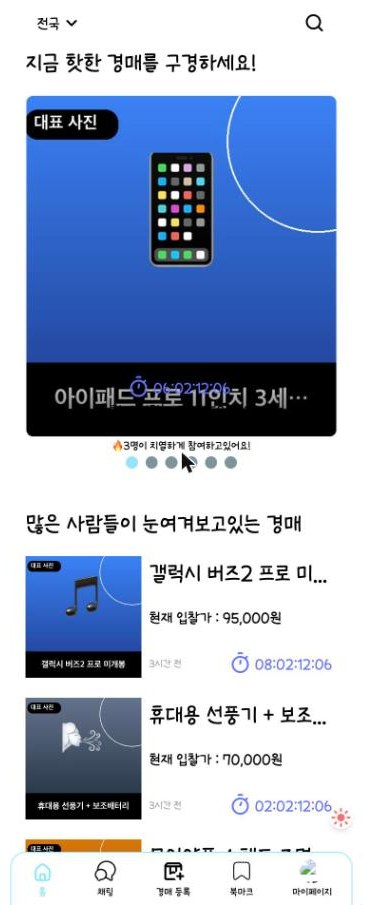
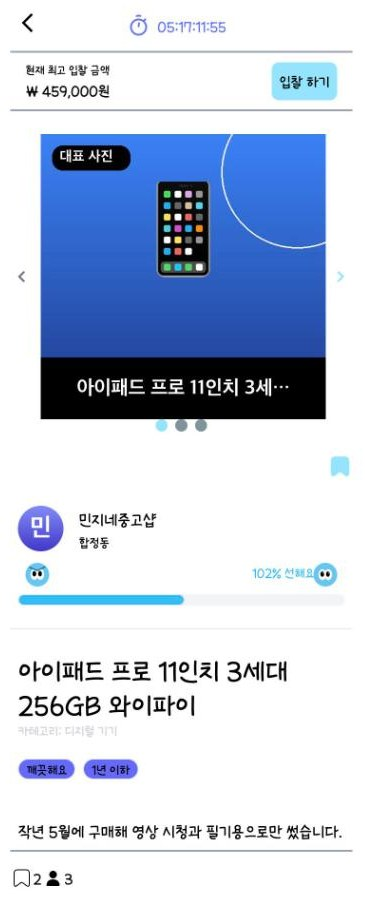
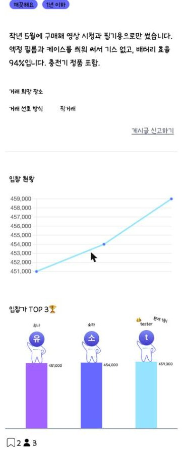
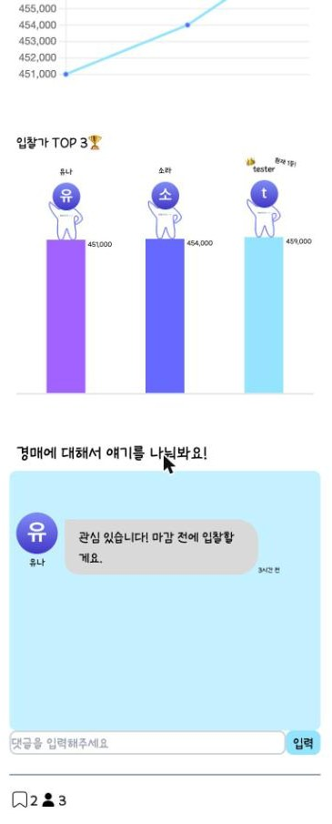
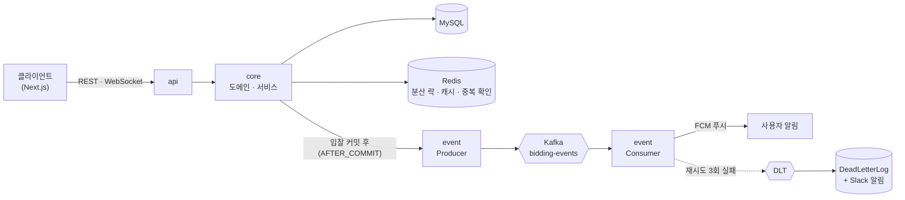

# HandsUp - 중고 경매 거래 플랫폼 (Backend)

[](https://github.com/ParkJuhan94/handsup-backend/actions/workflows/ci.yml)

물품을 등록하고 실시간으로 입찰하며, 채팅으로 거래하는 경매 서비스입니다. 프로그래머스 데브코스 팀 프로젝트(2024.02)로 시작했고, 이후 백엔드를 혼자 이어서 고도화하고 있습니다.
팀 단계와 개인 고도화 전반(2025)은 직접 설계·구현했고 AI는 검색·질문 보조로만 썼습니다. 2026년 6월부터 Claude Code를 사용했으며, 이 단계에서는 설계와 검증은 제가 하고
구현은 AI와 함께했습니다. 프론트엔드는 팀원들이 만든 것을 포크해 이 백엔드와 연동했습니다.

- 프론트엔드 : [ParkJuhan94/handsup-frontend](https://github.com/ParkJuhan94/handsup-frontend) (팀 프론트 [Programmers-HandsUp/FE-HandsUp](https://github.com/Programmers-HandsUp/FE-HandsUp)을 포크)
- 팀 프로젝트 원본 : [Programmers-HandsUp/BE-handsup](https://github.com/Programmers-HandsUp/BE-handsup)
- 작성 기준 : 2026-10-22, `main` 브랜치 커밋 `cebde3a` 시점의 코드와 구성 (이후 변경은 반영되지 않을 수 있습니다)

## 핵심 포인트

- 인증 : 액세스 토큰 30분, 리프레시 토큰 14일로 두고 재발급할 때마다 리프레시 토큰을 회전시킵니다. 로그아웃한 토큰과 이미 쓴 토큰은 블랙리스트로 막습니다.
- 동시성 : 분산 락보다 트랜잭션이 먼저 시작돼 동시 입찰 정합성이 깨지던 버그를, 락이 항상 트랜잭션 바깥에서 실행되도록 순서를 고정해 수정했습니다(100건 동시 입찰 테스트로 검증).
- 이벤트 : 입찰 알림을 Kafka로 분리하고 재시도 + DLT를 두었습니다. 잘못된 메시지가 컨슈머를 막던 문제는 `ErrorHandlingDeserializer`와 재현 테스트로 막았습니다.

<br>

## 화면

| 홈 | 경매 상세 (상단) | 경매 상세 (입찰 현황) | 경매 상세 (댓글) |
|:---:|:---:|:---:|:---:|
|  |  |  |  |

> 테스트 데이터 기준 화면입니다.

<br>

## 팀 단계와 개인 고도화

개인 고도화 항목은 모두 이 저장소의 커밋으로 확인할 수 있습니다.

| 구분 | 내용 |
|------|------|
| 팀 단계 | JWT 액세스·리프레시 인증과 인터셉터, 경매·입찰·리뷰·알림 API, DB 조회 최적화와 캐시 도입, 성능 테스트. 배포 파이프라인·분산 락·인기 검색어는 팀원이 구현 |
| 개인 · 인프라 | Docker 이미지 빌드 단계와 Compose 구성, MySQL 헬스체크와 wait-for-it으로 기동 순서 보장, CD 재작업(scp·ssh 액션, SSH 키 접속), Swagger 서버를 로컬 한정, 프론트 연동 CORS |
| 개인 · CI·품질 | CI에 MySQL·Redis·Kafka 서비스 컨테이너 구성, JaCoCo 커버리지 자동화, CI 빌드 병목 개선, 이후 Codecov 연동 |
| 개인 · 성능 | 경매 추천 API: 정렬 기준 enum과 Caffeine → Redis 2단 캐시, 지연 로딩 예외 수정, fetch join 제거와 DTO 조회, 대표 이미지 저장과 서브쿼리 개선, JVM GC 로그 수집. 로컬 시드 22건 기준 추천 API 응답 p50은 DB 5.5ms, Redis 2.4ms, Caffeine 1.0ms |
| 개인 · 이벤트 | 입찰 알림을 Kafka로 분리와 임베디드 Kafka E2E 테스트, 재시도 + DLT와 event 모듈 분리, Redis 기반 중복 처리, DLT의 DB 기록·Slack 알림과 Redis 장애 시 DB fallback, 중복 처리 개선 |
| 개인 · Kafka 서버 | Kafka를 앱과 분리된 EC2·저장소([handsup-kafka](https://github.com/ParkJuhan94/handsup-kafka))로 분리하고 힙 메모리를 제한, 이후 KRaft 모드 전환·환경 분리·kafka-ui(SSH 터널 전용) |
| 개인 · 기능 | OpenAI 기반 경매 설명 자동 생성, `@Value` 기반 설정 주입 정리, 검색 코드 구조 정리와 Elasticsearch 연동 시도 |
| 개인 · 운영 안정화 (Claude Code) | 설정 통합과 보안 강화, `.env` 자동 로드, CI/CD 개선과 compose 로컬·운영 분리, 첫 운영 배포 설정(ddl-auto), Codecov, GitHub Actions Node 24 대응, 컨테이너 재시작 정책, Testcontainers 호환 수정, 분산 락이 트랜잭션보다 안쪽에서 실행돼 동시 입찰 정합성이 깨지던 버그 수정 |
| 개인 · 보안·안정성 (Claude Code) | 인증 토큰 회전·로그아웃 무효화·401 응답, 역직렬화 실패 메시지가 컨슈머를 막던 문제, 같은 경매에 여러 번 입찰한 사용자의 리뷰 500 |
| 개인 · 개발 환경 (Claude Code) | CORS 설정화, 로컬 서버 포트 8082, 로컬 Kafka를 Redpanda로 교체하고 컨테이너 메모리 한도 추가, CD를 수동 실행으로 변경, 시드 데이터 스크립트 |

<br>

## 아키텍처



```
api     → REST API, WebSocket 엔드포인트, 인증 인터셉터
core    → 핵심 비즈니스 로직 (Service, Domain, Repository)
event   → Kafka 이벤트 처리 (Producer / Consumer, 재시도 · DLT)
```

> 의존 방향: `api → core, event` / `event → core`

<br>

## 기술 스택

| 분류 | 기술 |
|------|------|
| Backend | Java 17, Spring Boot 3.2, JPA, QueryDSL |
| Messaging | Kafka (운영: Apache Kafka 별도 EC2 / 로컬: Redpanda) |
| DB / Cache | MySQL, Redis (Redisson), Caffeine |
| Infra / CI·CD | Docker, AWS EC2 · S3, GitHub Actions |
| Test | JUnit 5, Mockito, Testcontainers, Embedded Kafka, JaCoCo + Codecov |
| 기타 | JWT(jjwt), Swagger, Firebase FCM, OpenAI API |

<br>

## 로컬 실행

```bash
# 인프라 (MySQL 3307, Redis 6380, Redpanda 29092)
cp .env.example .env   # 값 채우기
docker compose --env-file .env up -d mysql redis redpanda

# 서버 (기본 포트 8082)
./gradlew :api:bootRun
```

- Swagger : http://localhost:8082/swagger-ui/index.html
- 프론트와 연결하려면 [handsup-frontend](https://github.com/ParkJuhan94/handsup-frontend)를 `npm run dev`로 띄웁니다(3004).

<br>

## 상세 자료

<details>
<summary><b>DB ERD</b></summary>


</details>

<details>
<summary><b>CI/CD Pipeline (팀 단계)</b></summary>


> 현재 CD는 배포 서버를 꺼 둔 상태라 push로 자동 실행하지 않고, Actions 탭에서 수동 실행합니다.

</details>

<details>
<summary><b>API 리스트</b></summary>


</details>

<details>
<summary><b>테스트 결과</b></summary>


</details>

<br>

## 팀원 소개

<table>
  <tr>
    <th>손가현<br><sub>백엔드 · 팀장</sub></th>
    <th>박주한<br><sub>백엔드</sub></th>
    <th>허지호<br><sub>프론트엔드 · 팀장</sub></th>
    <th>신준혁<br><sub>프론트엔드</sub></th>
    <th>현세인<br><sub>프론트엔드</sub></th>
    <th>주장권<br><sub>프론트엔드</sub></th>
  </tr>
  <tr>
    <td align="center">
      <a href="https://github.com/hyun2371">
        
      </a>
    </td>
    <td align="center">
      <a href="https://github.com/ParkJuhan94">
        
      </a>
    </td>
    <td align="center">
      <a href="https://github.com/hj9118">
        
      </a>
    </td>
    <td align="center">
      <a href="https://github.com/oridori2705">
        
      </a>
    </td>
    <td align="center">
      <a href="https://github.com/imssein">
        
      </a>
    </td>
    <td align="center">
      <a href="https://github.com/JuJangGwon">
        
      </a>
    </td>
  </tr>
</table>
